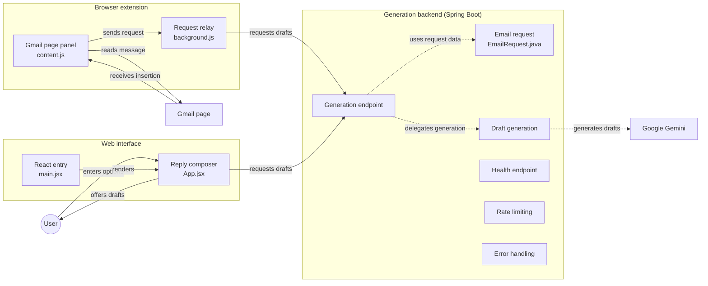

<div align="center">

# Quill Reply

**An AI email assistant that drafts replies inside Gmail.**
Delivered as a Chrome extension, powered by a Spring Boot backend and Google Gemini.

[](https://quill-reply.vercel.app/)


[Overview](#overview) · [Features](#features) · [Architecture](#architecture) · [Tech stack](#tech-stack) · [Getting started](#getting-started) · [Configuration](#configuration) · [API](#api)

</div>

---

## Overview

Quill Reply removes the blank-page problem from email. It reads the message you have open in Gmail, takes a few options from you, and offers reply drafts generated by Google Gemini that you can review before anything is sent.

The project has three parts that share one backend:

| Part | Role |
| --- | --- |
| **Browser extension** | Adds a panel to the Gmail page and reads the open message. |
| **Web interface** | A React app for composing replies outside Gmail. |
| **Generation backend** | A Spring Boot service that validates requests and asks Gemini for drafts. |

**Live demo:** https://quill-reply.vercel.app/

## Features

- **Works where you already write email.** A panel injected into the Gmail page reads the open message and brings the drafts back to you.
- **You stay in control.** You enter your options, the assistant offers drafts, and you choose what goes into the reply.
- **AI-generated drafts** produced by Google Gemini.
- **Standalone web interface** (React) that uses the same generation endpoint as the extension.
- **A guarded backend:** rate limiting, centralised error handling, and a health endpoint.

## Architecture




### How a request flows

**From Gmail (extension)**
1. The panel (`content.js`) reads the open message from the Gmail page.
2. It sends the request to the relay (`background.js`), which calls the generation endpoint.
3. The backend builds an `EmailRequest`, delegates to draft generation, and asks Google Gemini for drafts.
4. The drafts return to the panel, and the one you choose is inserted back into the Gmail page.

**From the web interface**
1. You enter your options in the reply composer (`App.jsx`, rendered from `main.jsx`).
2. The composer calls the same generation endpoint and offers the drafts it gets back.

### Backend responsibilities

| Component | Responsibility |
| --- | --- |
| Generation endpoint | Receives requests from both clients and returns drafts. |
| `EmailRequest.java` | The request model the endpoint works with. |
| Draft generation | Delegated by the endpoint; the only component that talks to Gemini. |
| Rate limiting | Protects the endpoint and the Gemini quota from excessive use. |
| Error handling | Turns failures into consistent, safe responses. |
| Health endpoint | A lightweight check that the service is up. |

## Tech stack

| Layer | Technology |
| --- | --- |
| Extension | Chrome extension (content script + background script) |
| Web interface | React |
| Backend | Java, Spring Boot |
| AI | Google Gemini |
| Hosting (web) | Vercel |

## Getting started

### Prerequisites

- JDK and Maven (or the Gradle wrapper, if the project uses it)
- Node.js 18 or newer and npm
- Google Chrome
- A Google Gemini API key

### 1. Clone

```bash
git clone https://github.com/Mtaijim/QuillReply.git
cd QuillReply
```

### 2. Run the backend

```bash
# set the key first (see Configuration below)
mvn spring-boot:run
```

### 3. Run the web interface

```bash
npm install
npm run dev
```

### 4. Load the extension in Chrome

1. Open `chrome://extensions`.
2. Turn on **Developer mode**.
3. Click **Load unpacked** and select the extension folder.
4. Open Gmail and open a message. The Quill Reply panel appears on the page.

## Configuration

| Variable | Purpose |
| --- | --- |
| `GEMINI_API_KEY` | Your Google Gemini API key, read by the backend. |

Keep keys out of source control. Use environment variables or a local, git-ignored configuration file.

## API

| Endpoint | Purpose |
| --- | --- |
| Generation endpoint | Accepts an `EmailRequest` and returns reply drafts. |
| Health endpoint | Returns the service status. |

Requests are rate limited, and errors are returned through a shared error handler.

## Author

**M. Taijim**, software engineer focused on backend engineering, distributed systems, security, and intelligent applications.

[GitHub](https://github.com/Mtaijim) · [LinkedIn](https://www.linkedin.com/in/Mtaijim) · [Portfolio](https://portfolio-phi-lyart-23.vercel.app/)
